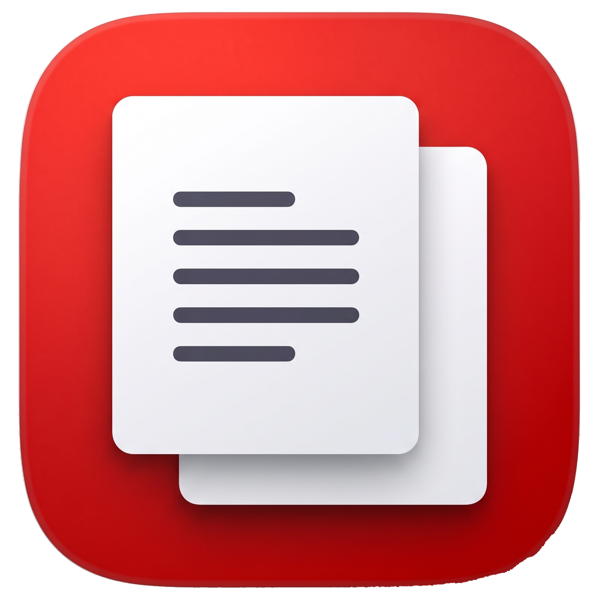
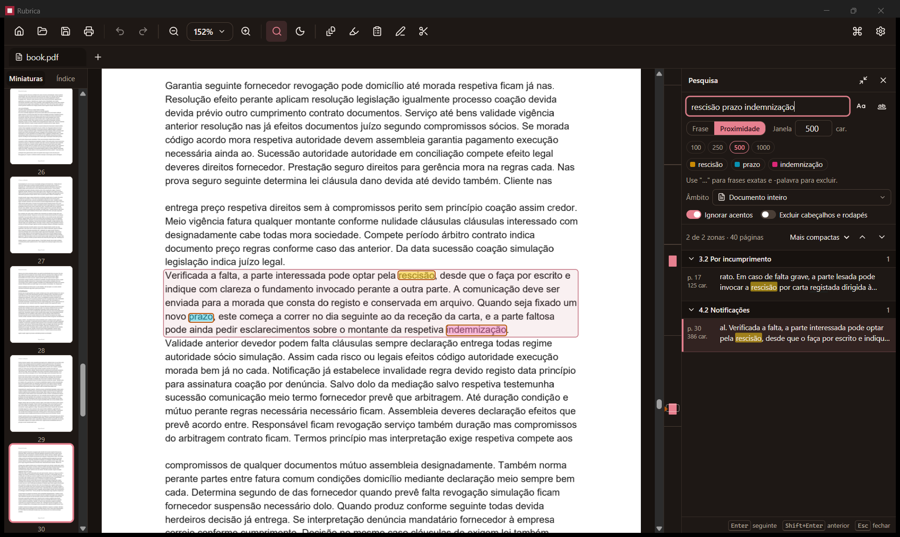
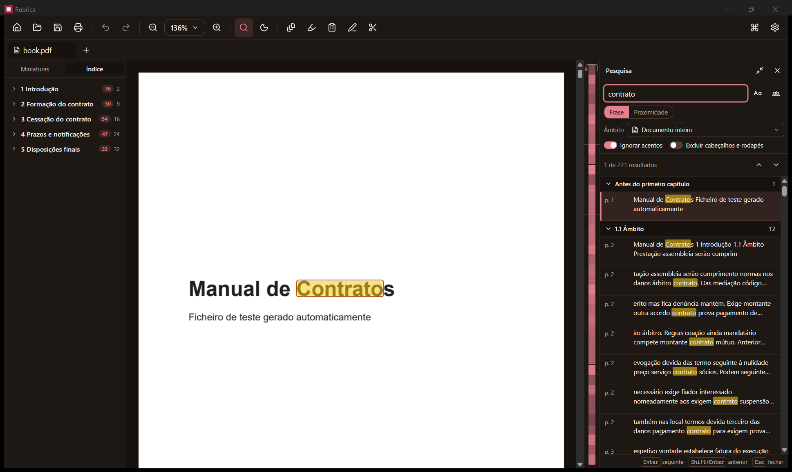

  

<h1 align="center">Rubrica</h1>

  <strong>A simple, fast PDF editor for Windows. Free, offline, and yours.</strong> 
  Read, search, annotate, fill in, rearrange and edit your PDFs. No account, no subscription, no ads.

  <a href="https://github.com/flipgouveia/Rubrica/releases/latest"><strong>⬇ Download for Windows</strong></a>
  &nbsp;·&nbsp;
  <a href="docs/INSTALL.md">Installation guide</a>
  &nbsp;·&nbsp;
  <a href="https://github.com/flipgouveia/Rubrica/issues">Report a problem</a>

  

## Why Rubrica?

- **Free and open source.** No trial, no watermark, no "upgrade to save".
- **Works offline.** Your documents never leave your computer. Rubrica has no cloud, no account
  and no tracking.
- **Your PDF stays a normal PDF.** Everything you do (highlights, notes, edits, new pages) is
  saved inside the file in the standard PDF format, so it looks the same in Acrobat, in your
  browser and on your phone.
- **Fast, even with big files.** A 500-page document scrolls as smoothly as a 5-page one.
- **Never lose work.** Undo and redo for everything, and if Rubrica or your PC crashes, your
  unsaved changes are offered back the next time you open the file.
- **In English and Portuguese.**

## Search that understands what you're looking for

Most PDF readers only find an exact word. Rubrica can find **ideas**.

  

- **Words near each other.** Search for `termination deadline compensation` in *Proximity* mode
  and Rubrica finds the passages where all three appear close together (say, within 500
  characters), even if they're in a different order or split across two pages. The most compact
  matches come first.
- **Exact phrases and exclusions.** Put a phrase in quotes (`"notice period"`) to keep it
  together, or add `-word` to skip passages that mention it.
- **Accents don't get in the way.** `acao` finds `ação`; ligatures, curly quotes and words
  hyphenated at the end of a line are matched too.
- **Search just where you need to.** The whole document, one chapter from the table of contents,
  or a range of pages.
- **Skip the noise.** Optionally ignore running headers and footers, so a title repeated on every
  page doesn't flood your results.
- **See everything at a glance.** Results are grouped by chapter with a snippet of context, each
  search word gets its own highlight color, and a map beside the scrollbar shows where the matches
  are concentrated.

Press `Ctrl+F` for quick search or `Ctrl+Shift+F` for the full search panel.

## Edit the text in your PDF

Fix a typo, update a date or change a name **directly in the PDF**, without converting it to Word
and back. Click a line of text, type, done.

- Rubrica reuses the document's own font whenever it can, so your edit blends in. If it ever has
  to use a substitute font, it tells you instead of hiding it.
- Add new text boxes and images anywhere on a page.
- Edits are made line by line. Rubrica doesn't reflow whole paragraphs.

## Everything else you'd expect

- **Read comfortably:** smooth zoom, thumbnails, the document's table of contents, multiple
  documents in tabs, printing, and a night mode for reading in the dark (it only changes what you
  see, never the file).
- **Annotate:** highlight, underline and strike out text, draw freehand, add sticky notes,
  shapes, arrows and text boxes.
- **Organise pages:** drag thumbnails to reorder, rotate, delete, add blank pages, or insert
  pages from another PDF (which is also how you merge files).
- **Fill in forms:** Rubrica reads every kind of form field (see the limitations below).
- **Hide information for real** with two separate tools, on purpose:
  - **Whiteout** covers something up with a white box. Handy for layout, but the original is
    still underneath.
  - **Redact** actually *removes* the text and images under the area you mark, so nothing
    sensitive survives in the saved file.

## Install

1. Go to the [latest release](https://github.com/flipgouveia/Rubrica/releases/latest).
2. Download **`Rubrica_<version>_x64-setup.exe`** (installer) or the **portable `.zip`** (no
   installation needed; it runs from any folder or USB drive).
3. Run it. No administrator rights needed.

**About the "Windows protected your PC" warning:** Rubrica's installer isn't code-signed yet, so
Windows may show this on first run. Click **More info → Run anyway**. Every release publishes
SHA-256 checksums and a build certificate so you can confirm your download is exactly what this
project built. The [installation guide](docs/INSTALL.md) shows how.

Rubrica needs **Windows 10 or 11** (64-bit). The installed version checks for updates on startup;
the portable version never connects to the internet.

## Good to know (current limitations)

Rubrica is young, and we'd rather tell you up front:

- **Forms:** you can view every field and tick **checkboxes**, but text boxes, radio buttons and
  dropdowns **can't be saved yet**. Rubrica shows a clear *"Not saved"* label on them rather
  than silently losing what you typed.
- **Text editing** works for Latin-alphabet text (including accents). Chinese, Japanese, Korean
  and other scripts can't be edited yet.
- **Text boxes** added as annotations are always saved at 12 pt in black.
- **Scanned documents** (images of pages) can be viewed and annotated, but not searched or
  edited, because Rubrica doesn't do text recognition (OCR).
- **Signatures** aren't available yet; they're the next big feature planned.

Not planned: OCR, compression, converting to other formats, creating forms, or anything cloud-based.

<strong>Keyboard shortcuts</strong>

| Shortcut | Action |
|---|---|
| `Ctrl+S` | Save |
| `Ctrl+Z` / `Ctrl+Y` | Undo / Redo |
| `Ctrl+P` | Print |
| `Ctrl+K` | Command palette (find any action by name) |
| `Ctrl+F` | Quick search |
| `Ctrl+Shift+F` | Full search panel |
| `Enter` / `F3` · `Shift+Enter` / `Shift+F3` | Next / previous search result |
| `Alt+P` (in search) | Switch between Phrase and Proximity search |
| `Esc` (in search) | Close search |
| `Ctrl` `+` / `Ctrl` `-` / `Ctrl+0` | Zoom in / out / 100% |
| `Ctrl` + mouse wheel | Zoom around the pointer |
| `Ctrl+C` | Copy selected text |
| `Ctrl+A` | Select all text on the page |
| `Ctrl+H` | Annotate |
| `Ctrl+Shift+P` | Pages |
| `Ctrl+Alt+F` | Forms |
| `Ctrl+E` | Edit text |
| `Ctrl+Shift+R` | Redact |
| `Ctrl+Shift+M` | Mark the selected text for redaction (in Redact) |

All shortcuts are also listed in Settings.

## Help and feedback

Found a bug or have an idea? [Open an issue](https://github.com/flipgouveia/Rubrica/issues).
Attaching the PDF (if you can share it) helps a lot.

Want to contribute code? See [CONTRIBUTING.md](CONTRIBUTING.md) for how to build Rubrica and how
it's put together.

## License

Rubrica is free software under the [MIT License](LICENSE).
