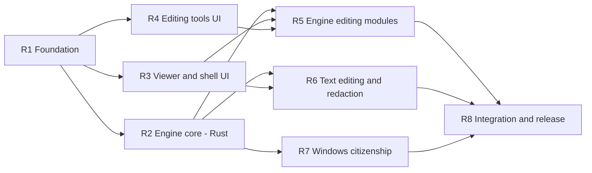

# Rubrica — parallel build orchestration

Eight agents, same discipline: **contracts first, exclusive path
ownership, waves**. What changes here is the parallelism enabler — this is one desktop app, not
a plugin server, so instead of an SDK test kit the seams are: (a) the full IPC surface stubbed
in Rust on day 0 with generated TS bindings, and (b) a TypeScript mock engine so UI agents
develop in a plain browser while the real engine is built in parallel.

## Waves and dependency graph



- **Wave 0 — serial:** R1 alone. Scaffold + the full IPC stub surface + mock engine + i18n +
  tokens + CI. Nothing starts before it.
- **Wave 1 — parallel (3):** R2 (Rust engine core), R3 (viewer/shell UI on mock), R4 (editing
  tools UI on mock).
- **Wave 2 — parallel (3):** R5 (real annotations/pages/forms engine + wiring R4's UI),
  R6 (text editing + redaction, engine and UI), R7 (installer, association, updater).
- **Wave 3 — serial:** R8 integrates, e2e, performance pass, release 0.1.0.

## Ownership map

| Agent | Owns exclusively | Frozen for everyone after |
|---|---|---|
| R1 (wave 0) | entire repo (creates it) | — stops when wave 0 ends |
| R2 | `src-tauri/**` (all engine core: session, tiles, protocols, journal, store) | `lib.rs`, specta builder, session public API freeze at end of wave 1 |
| R3 | `src/viewer`, `src/chrome`, `src/screens`, `src/ipc/mock/{document,render,text,history}.ts`, locales `chrome/viewer/screens/common` | tool-registration API published early as `src/chrome/TOOL-API.md` |
| R4 | `src/tools/{annotate,pages,forms}`, `src/ipc/mock/{annotations,pages,forms}.ts`, locales `tools-annotate/tools-pages/tools-forms` | — |
| R5 | `src-tauri/src/{commands,engine}/{annotations,pages,forms}.rs` + integration edits inside R4's tool folders (R4 has finished) | — |
| R6 | `src-tauri/src/{commands,engine}/{textedit,redact}.rs`, `src/tools/{text-edit,redact}`, `src/ipc/mock/{textedit,redact}.ts`, locales `tools-textedit/tools-redact` | — |
| R7 | `installer/`, `tauri.conf.json`, icons, updater config, `.github/workflows/release.yml` | — |
| R8 | `e2e/`, `docs/`, README, release; small cross-boundary fixes with a note, bugs filed otherwise | — |

Shared read-only for all: `docs/ARCHITECTURE.md`, `agents/CONTRACTS.md`, `src/ipc/bindings.ts`
(generated — regenerate, never edit), `src/tokens` after wave 0.

## How to launch (you do this manually)

R1 runs on `main` in the main checkout. For each parallel agent:

```bash
git worktree add ../rubrica-r2 -b agent/r2
```

Then one line per session:

> Read `agents/R2-engine-core.md` and execute it fully. Also read `docs/ARCHITECTURE.md` and `agents/CONTRACTS.md` first.

Merge order: wave 1 — R2 first, then R3, then R4 (disjoint paths; lockfile conflicts →
regenerate). Wave 2 — R5, R6, R7 any order. Tag after each wave.

## Subagent policy (all agents)

- A subagent gets: its task, the relevant CONTRACTS.md sections, and an explicit file list.
  Two subagents never share a file.
- Leaf work only (one tool, one engine module, one screen); the parent keeps wiring, review,
  and full-suite runs.
- Parent verifies each subagent's output compiles and tests pass before building on it.

## Machine notes (this dev box)

- Windows: `*.localhost` compound subdomains don't resolve for Node CLIs (browsers special-case
  them) — irrelevant here (no server), noted for any tooling that assumes it.
- Docker is NOT needed for this project (no Testcontainers — engine tests run against fixtures
  directly). Keep it that way; the machine's Docker Desktop is temperamental.
- CI must run on `windows-latest` (MSVC toolchain, WebView2, NSIS bundling).

## Reports

Every agent ends with `agents/reports/rN-report.md`: delivered, deviations, dependencies added,
contract problems found, and what the next wave must know.
